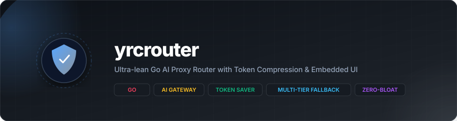
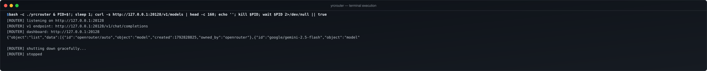

<a name="readme-top"></a>

<p align="center">
  
</p>

<p align="center">
  <a href="https://go.dev"></a>
  <a href="https://github.com/yanzyuyu/yrcrouter/releases"></a>
  <a href="#"></a>
  <a href="#"></a>
  <a href="#"></a>
  <a href="LICENSE"></a>
</p>

<p align="center">
  <strong>Ultra-lightweight Go AI proxy router, token optimizer, and multi-tier fallback gateway with an embedded dashboard.</strong>
</p>

---

## Operational Reality: The Need for a Lean Go Router

Developers relying on agentic AI tools like Claude Code, Cursor, Cline, and Copilot frequently encounter two major bottlenecks:

1. **The 429 Rate-Limit Barrier:** Running autonomous coding agents exhausts provider quotas in minutes. When an upstream model hits HTTP 429, tools crash or stall if they lack instant multi-tier fallback routing.
2. **Heavy Node/Next.js Runtime Overhead:** Popular routers like 9Router rely on Node.js and Next.js, consuming 150MB–250MB of RAM and hundreds of npm packages just to operate as a local localhost reverse proxy.

`yrcrouter` rebuilds the core 9Router concept into a **single, zero-dependency Go binary** requiring under 20MB of RAM. It delivers sub-millisecond route resolution, inline RTK-inspired token compression, native SSE streaming pass-through, and a self-contained embedded web dashboard.

<p align="right"><a href="#readme-top"></a></p>

---

## Architectural Capabilities & Guarantees

| Component | Target Mechanism | Operational Guarantee |
| :--- | :--- | :--- |
| **Proxy Engine** | Go `net/http` reverse proxy | Sub-millisecond latency routing to 40+ providers via standard OpenAI endpoints. |
| **3-Tier Fallback** | Automatic HTTP 429 / 5xx failover | Requests transparently switch from Tier 1 to Tier 2/3 without breaking IDE sessions. |
| **Token Compressor** | RTK regex normalization | Strips redundant git diff markers, trailing spaces, and blank lines (-20% to -40% input tokens). |
| **Stream Handler** | Native `http.Flusher` SSE pipe | Zero-copy streaming chunks directly to IDE clients with immediate flush. |
| **Web Dashboard** | Single binary embedding (`embed.FS`) | Fully functional web management UI served without Node.js, npm, or external assets. |

<p align="right"><a href="#readme-top"></a></p>

---

## Command Reference & Live Execution



### 1. Build Single Executable Binary

```bash
go build -o yrcrouter .
```

### 2. Start Router & Embedded Dashboard

```bash
./yrcrouter --port 20128
```

The router immediately listens on `http://localhost:20128`. Configure your AI coding tools to point to this endpoint:

* **Base URL:** `http://localhost:20128/v1`
* **API Key:** any string (or your local router secret)

### 3. CLI Options

| Flag | Default | Description |
| :--- | :--- | :--- |
| `--port` | `20128` | Local port for proxy and dashboard. |
| `--config` | `~/.config/yrcrouter/config.json` | Path to persistent configuration file. |

<p align="right"><a href="#readme-top"></a></p>

---

## Repository Structure

```
yrcrouter/
├── .gitignore               # Strict git untracking rules
├── LICENSE                  # MIT License
├── README.md                # Technical documentation
├── banner.svg               # Vector visual banner
├── terminal_demo.svg        # Real execution terminal snapshot
├── go.mod                   # Go 1.27 module definition
├── main.go                  # CLI entrypoint and graceful shutdown handler
└── internal/
    ├── config/
    │   └── config.go        # Thread-safe config loader and store
    ├── router/
    │   ├── compressor.go    # Token compression engine
    │   ├── compressor_test.go # Deterministic test suite
    │   ├── proxy.go         # 3-tier fallback router and SSE proxy
    │   └── types.go         # OpenAI API data contracts
    └── web/
        ├── server.go        # Static embedding and dashboard API
        └── static/
            ├── app.css      # 60-30-10 OKLCH zero-slop styles
            ├── app.js       # Zero-dependency dashboard frontend
            └── index.html   # Semantic HTML5 dashboard interface
```

<p align="right"><a href="#readme-top"></a></p>

---

## Verification & Test Suite

Run the full deterministic unit test suite:

```bash
go test -v ./...
```

Expected output:

```
=== RUN   TestCompressText
--- PASS: TestCompressText (0.00s)
=== RUN   TestCompressRequest
--- PASS: TestCompressRequest (0.00s)
PASS
ok      github.com/yanzyuyu/yrcrouter/internal/router   0.003s
```

All test cases run deterministically against the Go standard library without requiring external network connections.

<p align="right"><a href="#readme-top"></a></p>
